# AWS Inspector Container Scan Lab

Deploy a small AWS environment with Terraform, push intentionally outdated container images into Amazon ECR, and watch Amazon Inspector find the vulnerabilities. Then triage the findings, and export the report to an encrypted S3 bucket, either by hand in the console or automatically on a schedule.

The lab came from a real request: a team needed Inspector scan results for their container images, and the people who owned those images had no access to the Inspector console. Exporting reports to S3 on a schedule solves that. The people who need the findings never have to log in to Inspector.

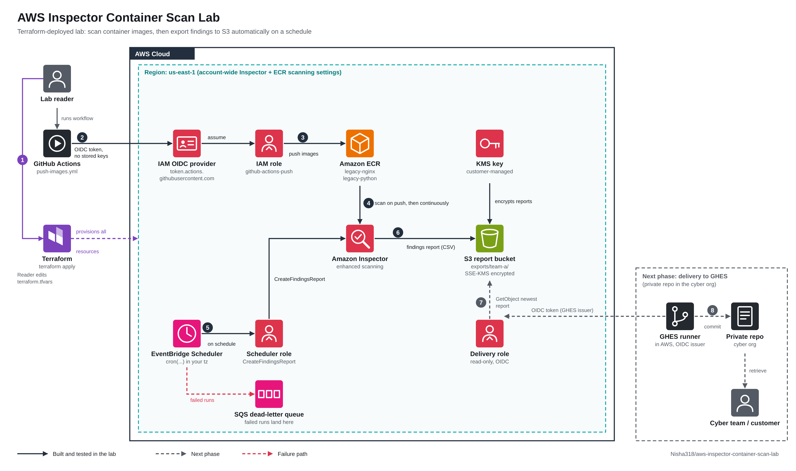

## What you build

| Piece | What it does |
| --- | --- |
| Two ECR repositories | Hold the outdated images (`legacy-nginx`, `legacy-python`) |
| Inspector enhanced scanning | Scans images on push and keeps rescanning as new CVEs are published |
| KMS key and S3 bucket | Receive the findings report. Inspector requires a customer-managed key |
| GitHub OIDC role (optional) | Lets a GitHub Actions workflow push images with no stored access keys |
| EventBridge Scheduler (optional) | Requests the findings report on a schedule, with no Lambda function or custom code |
| SQS dead-letter queue (optional) | Catches the error when a scheduled export fails after its retries. An empty queue means every run succeeded |

Terraform builds everything except the images. You push those yourself in step 2, which mirrors how developers deliver images to ECR in real pipelines. Triage and suppression rules in step 4 are console exercises, so Terraform does not manage them.

## Before you start

You need:

- An AWS account you control, and the AWS CLI configured for it
- Terraform 1.5 or later, or OpenTofu
- For step 2, either Docker with a Bash shell (Git Bash works on Windows) or a fork of this repo with GitHub Actions enabled
- The GitHub CLI (`gh`) if you use the Actions option

**Cost.** Inspector includes a 15-day free trial for new accounts. After that, ECR scanning is billed per image scanned and per rescan. The other resources cost pennies per month. Run the cleanup step when you finish.

### Pre-flight checks

Inspector and the GitHub OIDC provider are account-wide settings, and AWS allows only one of each. Run these first so Terraform doesn't collide with something that already exists.

```bash
# Is Inspector already enabled for ECR? Look for "ECR": {"status": "ENABLED"}
aws inspector2 batch-get-account-status

# Does the account already have the GitHub OIDC provider?
aws iam list-open-id-connect-providers

# What is the current ECR scanning configuration?
aws ecr get-registry-scanning-configuration
```

What the results mean for your settings:

- If ECR scanning is already enabled, set `manage_inspector = false` in `terraform.tfvars`. Terraform will then leave the account-wide Inspector settings alone.
- If the list of OIDC providers includes `token.actions.githubusercontent.com`, set `create_github_oidc_provider = false`. Terraform will look it up instead of creating a second one.

This lab sets registry scanning to continuous, but it scopes the filter to repositories under `inspector-lab/`, so other repositories in the account are not affected by the filter.

## Repository layout

```
.
├── providers.tf             AWS provider and shared lookups
├── variables.tf             Core inputs
├── inspector.tf             Enables Inspector and sets ECR scanning
├── ecr.tf                   The two lab repositories
├── storage.tf               KMS key and report bucket, with Inspector's access policies
├── github_oidc.tf           Optional OIDC role for the Actions workflow
├── scheduled_export.tf      Optional scheduled findings export
├── outputs.tf
├── scripts/
│   ├── push-images.sh       Pushes the outdated images (option A)
│   └── export-report.sh     Optional manual export from the CLI
├── .github/workflows/
│   ├── push-images.yml      Pushes the outdated images (option B)
│   └── export-report.yml    Optional manual export from Actions
└── docs/images/             Diagrams and screenshots used in this README
```

## Step 1: Deploy the infrastructure

Create a `terraform.tfvars` file. It is gitignored, so your account details stay out of the repo. Start with the minimum:

```hcl
aws_region = "us-east-1"

# Set to false if the pre-flight checks showed these already exist
manage_inspector            = true
create_github_oidc_provider = true
```

If you plan to use the GitHub Actions option in step 2, add your repository:

```hcl
github_repo = "YOUR-USERNAME/aws-inspector-container-scan-lab"
```

Repositories created after July 15, 2026 send an OIDC subject that includes immutable numeric IDs for the owner and the repo. The IAM trust policy needs those IDs, so look them up and add them:

```bash
gh api repos/YOUR-USERNAME/aws-inspector-container-scan-lab --jq '{owner: .owner.id, repo: .id}'
```

```hcl
github_owner_id = "12345678"
github_repo_id  = "987654321"
```

Older repositories that still use the plain subject format can leave both IDs out. Set both or neither.

Then deploy:

```bash
terraform init
terraform plan
terraform apply
```

Keep the outputs handy. You will use `ecr_repository_urls`, `report_bucket`, `report_kms_key_arn`, and (if you set `github_repo`) `github_actions_role_arn`.

## Step 2: Push the outdated images

Terraform creates the repositories but leaves them empty. Pick one option.

### Option A: Run the script

```bash
bash scripts/push-images.sh
```

The script logs in to ECR, pulls `nginx:1.21.6` and `python:3.9.7-slim-bullseye` for `linux/amd64`, retags them, and pushes. It needs a running Docker daemon. If you deployed to another region or changed `project_name`, set `AWS_REGION` and `PROJECT_NAME` first.

### Option B: Run the GitHub Actions workflow

This option needs no Docker or Bash on your computer.

1. Set the repository variables, using the role ARN from the Terraform outputs:

   ```bash
   gh variable set AWS_ROLE_ARN --body "arn:aws:iam::123456789012:role/inspector-lab-github-actions-push"
   gh variable set AWS_REGION   --body "us-east-1"
   ```

2. In the repository, open **Actions**, choose **Push lab images to ECR**, and click **Run workflow**.

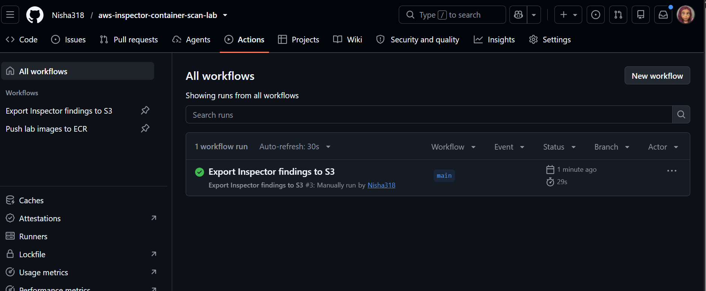

The workflow requests a GitHub OIDC token and exchanges it for short-lived AWS credentials. No access keys are stored anywhere. If the login fails with `Not authorized to perform sts:AssumeRoleWithWebIdentity`, the cause is almost always a mismatch between the token subject and the role's trust policy. See [Troubleshooting](#troubleshooting).

Workflow logs on a public repository are public. Both workflows mask your AWS account ID, so the bucket name and KMS key ARN print with `***` where the 12 digits would be. If you fork this into a public repo, keep that masking in place.

## Step 3: Watch Inspector scan the images

Give Inspector a few minutes after the push finishes. Then look at the results in three places.

**In ECR.** Open **Amazon ECR**, then **Private registry**, then **Repositories**. Open `inspector-lab/legacy-nginx` and check the vulnerability columns on the image. You will see counts by severity. Open an image to see the individual findings.

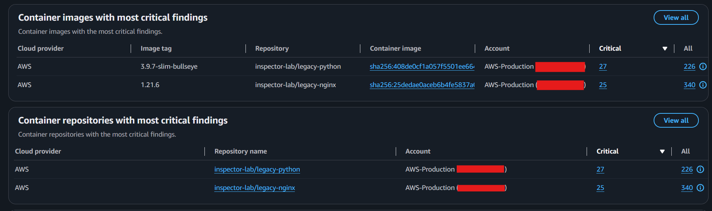

**On the Inspector dashboard.** Open **Amazon Inspector** and stay on the **Summary** page. It shows active findings by severity, plus two numbers that matter for prioritizing: how many findings have a public exploit available, and how many have a fix available.

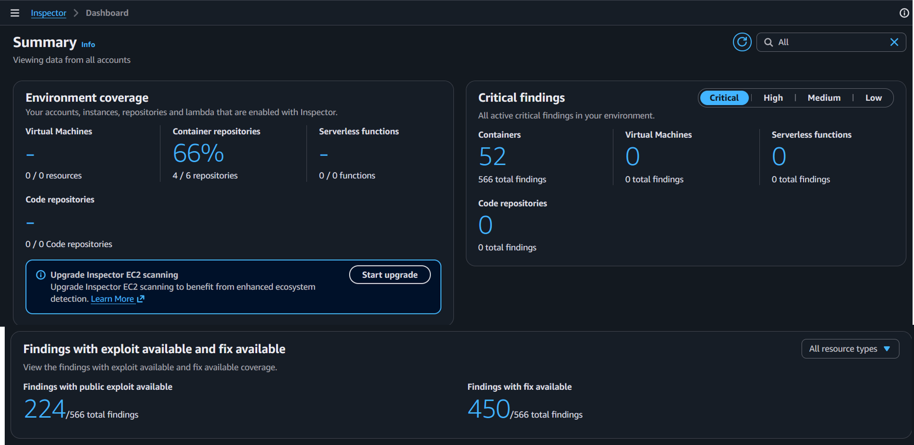

Scroll down to see which images carry the most critical findings.


**In the Findings list.** Choose **Findings** in the left navigation. Open one finding and look at the CVE, the affected package, the fixed-in version, and the exploit and score details. This is the information a team needs to decide what to patch.

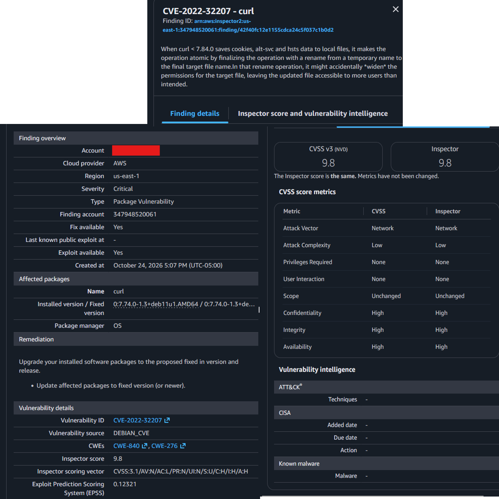

When this lab was built, the two images produced 566 active findings. That included 52 critical, 232 high, 249 medium, and 25 low. The nginx image carried 340 findings and the Python image carried 226. Your numbers will differ as the vulnerability database changes.

Why these images? Inspector gives full findings only for operating systems it supports for ECR scanning, such as Debian 11 and later. Images on discontinued operating systems produce only limited informational findings, which makes a weak demo.

### How to read what you see

- **Severity** tells you how serious a vulnerability is. Critical and high findings need attention first. Low findings can usually wait for routine maintenance.
- **Fix available** means a patched version of the package exists. In the lab run, 450 of 566 findings had a fix, which is about 80 percent. For container images, the usual fix is to rebuild on a newer base image.
- **Public exploit available** means working exploit code is known to exist. In the lab run, that was 224 findings. A critical finding with a public exploit and a fix available goes to the top of the list.
- **No fix available** is a different decision. You may accept the risk, add a control around it, or wait for the vendor.

## Step 4: Triage and suppress findings

A real team cannot work through hundreds of findings at once. Inspector lets you create a **suppression rule** that hides findings matching a filter, so the list shows what you want to act on.

This step uses a simple rule on severity so you can see the effect clearly. In real use, narrower rules such as "no fix available" are usually a better choice.

1. In Inspector, open **Findings**. Set the **Finding status** to **Active** and add the filter **Severity: Low**. Note the count in the heading. In the lab run it was 25.
2. Choose **Create suppression rule**. Enter a name and description, such as "Suppress low severity findings," and confirm the filter shows **Severity: Low**.
3. Choose **Save**.

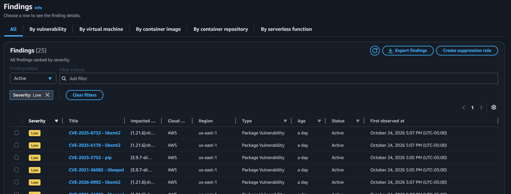

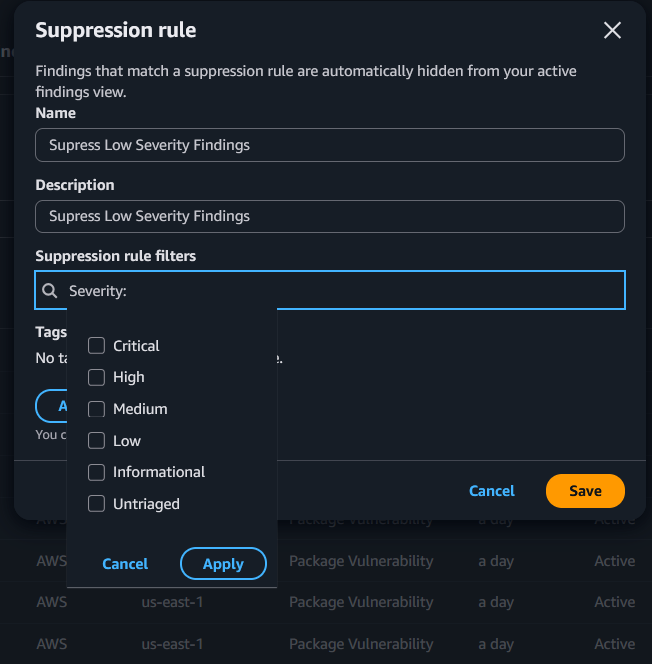

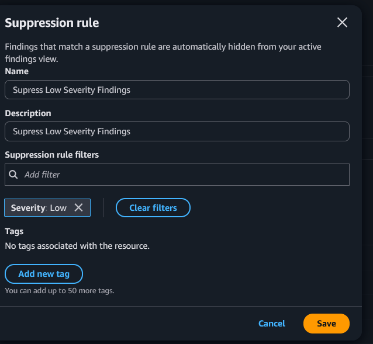

Inspector applies the rule in the background. Refresh the Findings page every minute or so. The count of Active low findings falls in steps until it reaches zero. Then change the **Finding status** to **Suppressed** and the same findings appear there.

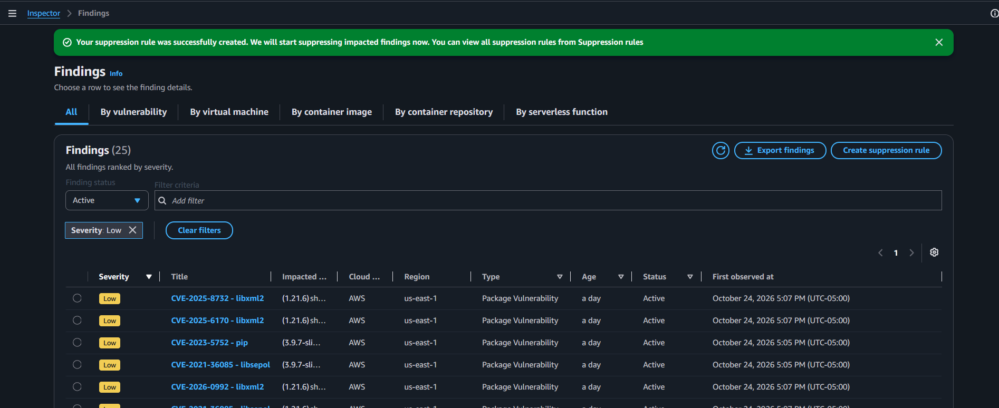

[Watch a short walkthrough of this step](https://www.loom.com/share/REPLACE_WITH_YOUR_LINK)

A note on counts: the findings table stops counting at 200 and shows **200+**, so an unfiltered total cannot show a before and after. Filter on severity as above and the count stays exact.

**Suppressed does not mean fixed.** A suppression hides a finding, and the vulnerability is still there. In a real environment, record why you suppressed it, who approved it, and when to review it. Suppressed findings also drop out of any report built from active findings, including the scheduled export in step 6.

## Step 5: Export the findings report to S3

1. In Inspector, open **Findings** and check the **Finding status**. A report of active findings leaves out anything you suppressed in step 4. If you want the full report, delete the suppression rule first under **Suppression rules** and wait for the findings to return to Active.
2. Choose **Export findings** (top right).
3. Pick **CSV** (or JSON).
4. For the S3 destination, enter the bucket from the `report_bucket` output.
5. For the KMS key, choose the key whose alias is `alias/inspector-lab-report`, or paste `report_kms_key_arn`.
6. Choose **Export**, and wait for the status to show success.

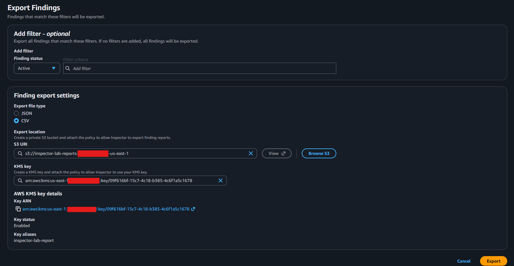

Open the bucket in S3 and download the file. The report is encrypted with the lab key, and S3 decrypts it for you if your own identity has access to the key. Open the CSV in a spreadsheet to see one row per finding, with the severity, whether a fix is available, the package, and the fixed-in version.

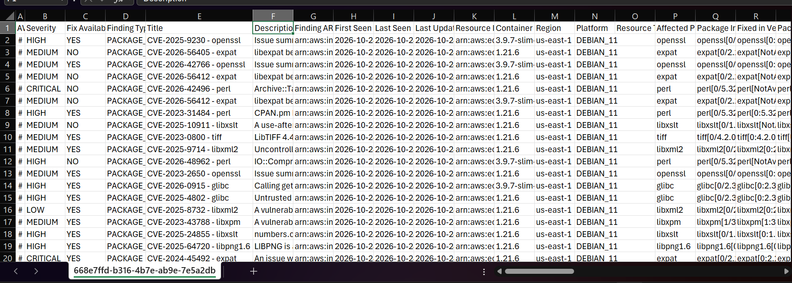

Why a customer-managed key? Inspector cannot write a report with the AWS-managed `aws/s3` key, because that key's policy cannot be edited. The key and bucket policies in `storage.tf` allow the Inspector service to write, and they are scoped to your account and to Inspector report ARNs only.

**Spreadsheet tip.** Excel can mangle 12-digit AWS account IDs in CSV files. The first column in the screenshot above shows `#` because the account ID is too wide for the cell and gets converted to scientific notation. Import the file with the account column set to Text.

### Optional: Run the export from the CLI or Actions

You can also request the same report without the console. These produce a report for the lab repositories only.

```bash
bash scripts/export-report.sh
```

Or run the **Export Inspector findings to S3** workflow from the Actions tab. Both wait for the report to finish and print where it landed.

## Step 6 (optional): Export automatically on a schedule

This is for the case where the people who need findings can't use Inspector, or where you want a report on a regular cadence. EventBridge Scheduler calls the Inspector `CreateFindingsReport` API directly, with no Lambda function or custom code. Inspector writes the file using the same bucket and key policies from step 5.

Terraform creates three things for this step: the schedule, a small IAM role that lets Scheduler call Inspector, and an SQS dead-letter queue. Scheduler retries a failed run twice, an hour apart. If it still fails, the error message goes to the dead-letter queue instead of disappearing. Scheduler has no console page that lists failed runs, so the queue is how you find out. An empty queue means every run succeeded.

Add these to `terraform.tfvars`:

```hcl
export_schedule          = "cron(0 4 ? * MON *)"   # every Monday at 04:00 in the time zone below
export_schedule_timezone = "America/Chicago"
export_customer          = "team-a"                # reports land under exports/team-a/
```

EventBridge cron has six fields: minute, hour, day of month, month, day of week, and year. A weekly schedule puts `?` in the day-of-month field and a day name in the day-of-week field. For a Sunday night run, use `cron(0 22 ? * SUN *)`. Set the time zone to where the report readers work, and Scheduler handles daylight saving shifts for you.

Then run `terraform apply`. Leave `export_schedule` empty to skip every resource in this feature.

To test without waiting a week, use a one-time schedule a few minutes ahead. Allow time for the apply to finish first, and use the 24-hour clock:

```hcl
export_schedule = "at(2026-11-02T09:30:00)"
```

When the time passes, a new report appears in `exports/<customer>/` in the bucket within a minute or two. Change the value back to your real schedule afterward and apply again. The report contains active findings for the lab repositories only, so suppressed findings are left out.

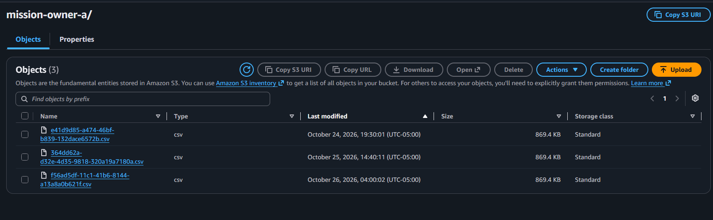

If no report shows up, check the dead-letter queue. A failed run leaves its error there for 14 days.

```bash
aws sqs receive-message \
  --queue-url "$(terraform output -raw export_failure_queue_url)" \
  --attribute-names All --message-attribute-names All --max-number-of-messages 10
```

You can also open the schedule in the EventBridge console and look at its **Monitoring** tab.

Each run adds a new file with a generated name. For anything long-running, add an S3 lifecycle rule to expire old reports.

## Troubleshooting

**The workflow fails with `Not authorized to perform sts:AssumeRoleWithWebIdentity`.** The IAM trust policy did not match the OIDC token. The diagram below shows the handshake. Step 5 is where most failures happen, when STS compares the token to the role's trust policy.


Print the token's `sub` claim in a debug step, compare it to the `sub` condition on the role, and check for these causes in order:

1. The workflow is missing `permissions: id-token: write`.
2. The role's `sub` condition uses `repo:OWNER/REPO`, but the token uses the immutable form `repo:OWNER@OWNER_ID/REPO@REPO_ID`. Set `github_owner_id` and `github_repo_id`, then apply.
3. The workflow ran from a branch other than `github_branch`.
4. The provider's audience does not include `sts.amazonaws.com`.

After you change the trust policy, run `terraform apply` and confirm the change landed with `aws iam get-role`. The configure-credentials action retries for a couple of minutes before it reports failure, so a failed run can take a while to appear.

**`EntityAlreadyExists` for the OIDC provider.** Your account already has one. Set `create_github_oidc_provider = false`.

**Inspector or scanning is already enabled.** Set `manage_inspector = false`.

**No findings appear.** Wait a few minutes after the push. Confirm the image is on a supported operating system and that registry scanning is set to enhanced.

**The suppression rule did not change the count right away.** Inspector applies rules in the background and can take a few minutes. Refresh the page. While it runs, you may see partial counts, and Active plus Suppressed should still add up to the original total.

**The findings table shows `200+`.** The console caps its count. Add a severity filter, or use the Summary page or the **By container repository** tab for totals.

## GovCloud notes

The Terraform code builds ARNs with the partition lookup, so it works with `arn:aws-us-gov`. Confirm that each service is available in your GovCloud region before you deploy, and check that Inspector's endpoints and the report export behave the same way in your environment.

## Clean up

Destroy the lab when you finish so the trial and charges stop. Save any screenshots you want first.

1. If you created a suppression rule in step 4, delete it under **Inspector, Suppression rules**. Terraform does not manage it, so `terraform destroy` will not remove it.
2. Run:

   ```bash
   terraform destroy
   ```

This removes the repositories (including images), the report bucket and its contents, and the schedule. The KMS key is scheduled for deletion after a 7-day waiting period. If you set `manage_inspector = true`, Terraform also disables Inspector scanning for ECR in the account. If you set it to `false`, Terraform leaves Inspector as it found it.

3. If you used the GitHub Actions option, the `AWS_ROLE_ARN` repository variable now points to a role that no longer exists. Delete the variable, or leave it for the next time you deploy and update it with the new role ARN.

If you set `create_github_oidc_provider = false`, the existing GitHub OIDC provider stays in the account because Terraform never created it.

## License

Released under the [MIT License](LICENSE).
