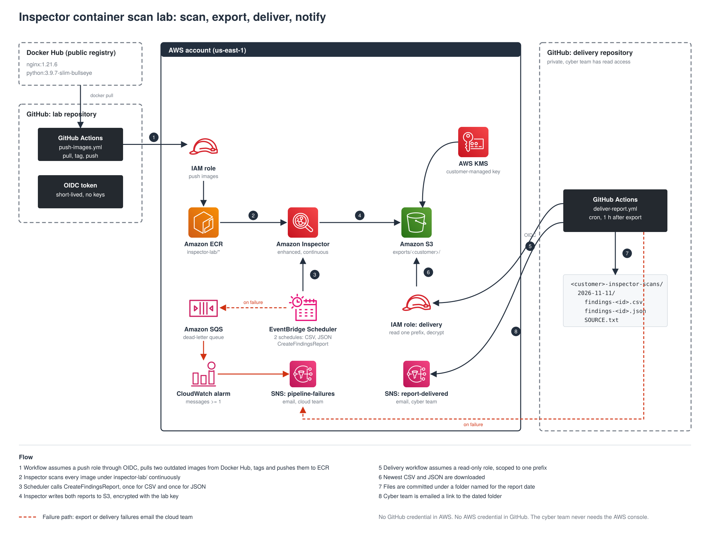
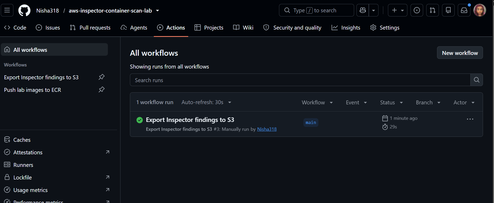
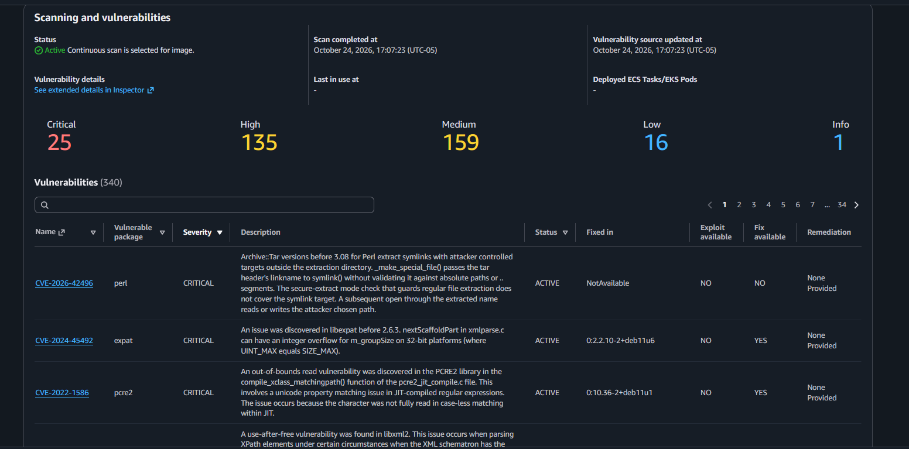
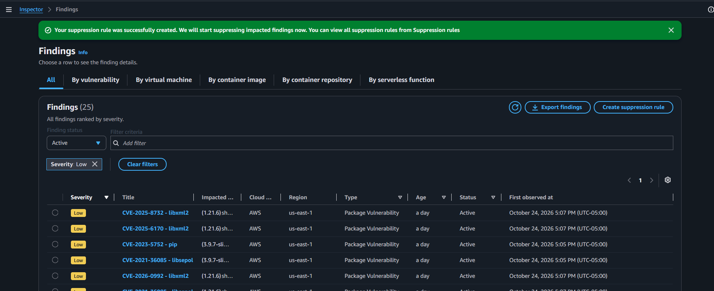
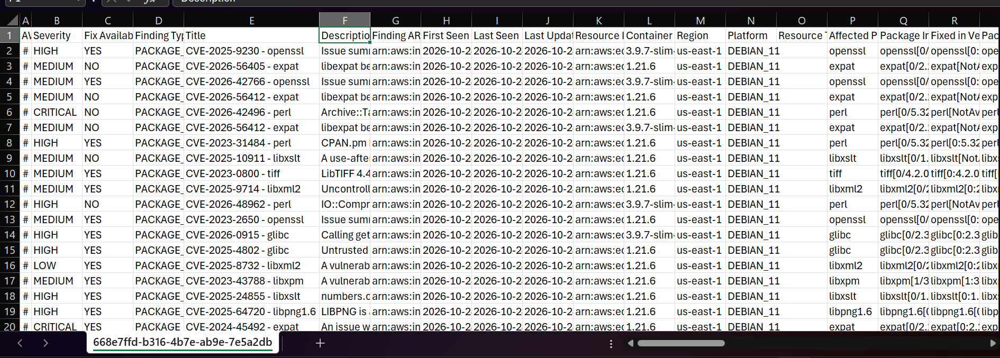
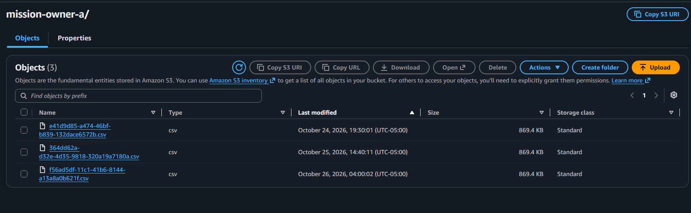

# AWS Inspector Container Scan Lab

Push two outdated container images into Amazon ECR, let Amazon Inspector find the vulnerabilities, export the findings to S3 on a schedule, and deliver them to a team that has no AWS access by committing the reports into a GitHub repository and emailing a link.



This README is the walkthrough: what to type, what to click, and how to tell each step worked. The reasoning behind the design, the IAM policies, and the console tour live in [docs/how-it-works.md](docs/how-it-works.md).

## Contents

| Step | What you do | Time | Needed for |
| --- | --- | --- | --- |
| [0](#step-0-prerequisites) | Install tools, run pre-flight checks | 15 min | everything |
| [1](#step-1-deploy-the-infrastructure) | Deploy with Terraform | 5 min | everything |
| [2](#step-2-push-the-outdated-images) | Push the images to ECR | 5 min | everything |
| [3](#step-3-confirm-inspector-found-the-vulnerabilities) | Confirm Inspector scanned them | 10 min wait | everything |
| [4](#step-4-optional-suppress-low-severity-findings) | Suppress low findings | 5 min | optional |
| [5](#step-5-export-a-findings-report-by-hand) | Export a report from the console | 5 min | optional, teaches step 6 |
| [6](#step-6-export-automatically-on-a-schedule) | Export on a schedule | 10 min | step 7 |
| [7](#step-7-deliver-the-reports-to-a-github-repository) | Deliver to a GitHub repo and email a link | 20 min | the full pipeline |
| [8](#step-8-clean-up) | Destroy everything | 5 min | your wallet |

Steps 1 through 3 are the core lab. Steps 6 and 7 together are the automated delivery pipeline. Budget about 90 minutes for all of it, most of that waiting on Inspector.

**Cost.** Inspector has a 15-day free trial for new accounts. After that, ECR scanning is billed per image scanned. Everything else is pennies. Do step 8 when you finish.

## Step 0: Prerequisites

Install:

| Tool | Download | Needed for |
| --- | --- | --- |
| AWS CLI v2 | [aws.amazon.com/cli](https://aws.amazon.com/cli/) | everything |
| Terraform 1.5+ | [developer.hashicorp.com/terraform/install](https://developer.hashicorp.com/terraform/install) | everything (or OpenTofu, below) |
| OpenTofu | [opentofu.org/docs/intro/install](https://opentofu.org/docs/intro/install/) | alternative to Terraform. Replace `terraform` with `tofu` in every command |
| Git | [git-scm.com/downloads](https://git-scm.com/downloads) | everything. On Windows, use the Git Bash shell it installs |
| GitHub CLI (`gh`) | [cli.github.com](https://cli.github.com/) | steps 2 (option B) and 7 |
| Docker Desktop | [docker.com/products/docker-desktop](https://www.docker.com/products/docker-desktop/) | step 2 (option A) only |

You also need an AWS account you control, with the CLI configured for it (`aws configure`), and a GitHub account. Log the GitHub CLI in with `gh auth login`.

Then clone this repository and run the pre-flight checks:

```bash
git clone https://github.com/Nisha318/aws-inspector-container-scan-lab.git
cd aws-inspector-container-scan-lab

aws inspector2 batch-get-account-status --query 'accounts[0].resourceState.ecr.status' --output text
aws iam list-open-id-connect-providers --query 'OpenIDConnectProviderList[].Arn' --output text
```

Note the two answers. They set two values in the next step.

**Checkpoint:** both commands return without an error.

## Step 1: Deploy the infrastructure

1. Copy the example variables file and open it:

   ```bash
   cp terraform.tfvars.example terraform.tfvars
   ```

   `terraform.tfvars` is gitignored. Your account details never reach the repo.

2. In the **Core** block, set two values from the pre-flight checks:

   | Pre-flight answer | Set |
   | --- | --- |
   | Inspector status was `ENABLED` | `manage_inspector = false` |
   | Provider list included `token.actions.githubusercontent.com` | `create_github_oidc_provider = false` |

   Otherwise leave both `true`.

3. If you will push images with GitHub Actions in step 2 (option B), fork this repository, then in the **GitHub Actions push** block set `github_repo` to your fork and fill in the two IDs:

   ```bash
   gh api repos/YOUR-USERNAME/aws-inspector-container-scan-lab --jq '{owner: .owner.id, repo: .id}'
   ```

   Repositories created after July 15, 2026 need the IDs. Older ones can leave both out.

4. Deploy:

   ```bash
   terraform init
   terraform apply
   ```

**Checkpoint:** `Apply complete!` with 9 to 14 resources added, and an `ecr_repository_urls` output listing two repositories.

## Step 2: Push the outdated images

Pick one option.

**Option A, from your computer.** Needs Docker running.

```bash
bash scripts/push-images.sh
```

**Option B, from GitHub Actions.** Needs the fork and `github_repo` from step 1. Set two repository variables on your fork, then run the workflow:

```bash
gh variable set AWS_ROLE_ARN --body "$(terraform output -raw github_actions_role_arn)"
gh variable set AWS_REGION   --body "$(terraform output -raw aws_region)"
gh workflow run push-images.yml
gh run watch
```

**Checkpoint:** either the script prints two `Pushed` lines, or the workflow run is green.



If the workflow fails at "Assume the lab IAM role," see [Troubleshooting](#troubleshooting).

## Step 3: Confirm Inspector found the vulnerabilities

Inspector needs a few minutes after the push. Poll until both images show `ACTIVE`:

```bash
aws inspector2 list-coverage --filter-criteria '{"resourceType":[{"comparison":"EQUALS","value":"AWS_ECR_CONTAINER_IMAGE"}]}' --query 'coveredResources[].[resourceMetadata.ecrImage.tags[0],scanStatus.statusCode]' --output table
```

Then count the findings:

```bash
aws inspector2 list-findings --filter-criteria '{"ecrImageRepositoryName":[{"comparison":"PREFIX","value":"inspector-lab/"}],"findingStatus":[{"comparison":"EQUALS","value":"ACTIVE"}]}' --max-results 1 --query 'length(findings)'
```

**Checkpoint:** the count is `1` (meaning at least one). In the console, **Amazon ECR**, **Repositories**, `inspector-lab/legacy-nginx`, click the image tag, and you see a vulnerability table with severity counts. The lab run produced 566 findings across both images. Yours will differ.



Where to look next, and how to read severity, fix availability, and exploit availability: [how-it-works.md, Reading the findings](docs/how-it-works.md#reading-the-findings).

## Step 4 (optional): Suppress low severity findings

1. In **Amazon Inspector**, open **Findings**. Set **Finding status** to **Active** and add the filter **Severity: Low**. Note the count.
2. Choose **Create suppression rule**. Name it, confirm the filter shows **Severity: Low**, and **Save**.
3. Refresh the Findings page every minute or so.

**Checkpoint:** the Active low count falls to zero, and the same findings appear under **Finding status: Suppressed**.



Suppressed findings are left out of every report from here on, including the scheduled exports. Delete the rule under **Suppression rules** to put them back.

## Step 5: Export a findings report by hand

This is the manual version of what step 6 automates. Do it once to see what the report looks like.

1. In **Amazon Inspector**, open **Findings** and choose **Export findings** (top right).
2. Pick **CSV**.
3. S3 destination: the bucket from `terraform output report_bucket`.
4. KMS key: `alias/inspector-lab-report`.
5. Choose **Export** and wait for the success banner.

Then download it:

```bash
aws s3 ls "s3://$(terraform output -raw report_bucket)/" --recursive
aws s3 cp "s3://$(terraform output -raw report_bucket)/<key from the listing>" findings.csv
```

**Checkpoint:** `findings.csv` opens in a spreadsheet with one row per finding.



Excel turns 12-digit account IDs into scientific notation. Import with that column set to Text.

To do the same from the CLI or from Actions: `bash scripts/export-report.sh`, or run the **Export Inspector findings to S3** workflow.

## Step 6: Export automatically on a schedule

Goal: a CSV and a JSON report land in S3 on a schedule with no one involved.

1. In `terraform.tfvars`, uncomment the **Scheduled export** block. For the first run, use a one-time schedule a few minutes ahead, 24-hour clock, in the time zone you set:

   ```hcl
   export_customer          = "team-a"
   export_schedule          = "at(2026-11-12T09:30:00)"
   export_schedule_timezone = "America/Chicago"
   ```

2. Apply. Expect 5 to add: two schedules, a role, a policy, and a dead-letter queue. The CSV schedule fires at the time you set and the JSON schedule ten minutes later, because Inspector generates one report at a time per account.

   ```bash
   terraform apply
   ```

3. When the time passes, check the bucket:

   ```bash
   aws s3 ls "$(terraform output -raw scheduled_export_prefix)"
   ```

**Checkpoint:** two objects, one `.csv` and one `.json`, each named after an Inspector report ID. The JSON arrives about ten minutes after the CSV.



If nothing appears after five minutes, the error is in the dead-letter queue:

```bash
aws sqs receive-message --queue-url "$(terraform output -raw export_failure_queue_url)" --max-number-of-messages 2
```

4. Set a real cadence and apply again:

   ```hcl
   export_schedule = "cron(0 4 ? * MON *)"   # Mondays at 04:00 in export_schedule_timezone
   ```

Set `export_schedule = ""` to remove everything this step created.

## Step 7: Deliver the reports to a GitHub repository

Goal: a second, private repository that the readers can open. A workflow in it pulls each new report from S3 and commits it under `<customer>-inspector-scans/<date>/`, then emails the readers a link.

### 7a. Create the delivery repository

From the folder that holds your clone of the lab:

```bash
gh repo create YOUR-USERNAME/inspector-findings-demo --private --clone
cp -r aws-inspector-container-scan-lab/delivery-repo-template/. inspector-findings-demo/
cd inspector-findings-demo
git add -A
git commit -m "Add Inspector findings delivery workflow"
git push -u origin main
gh api repos/YOUR-USERNAME/inspector-findings-demo --jq '{owner: .owner.id, repo: .id}'
cd ../aws-inspector-container-scan-lab
```

Keep the two IDs the last command printed. Do not enable branch protection on `main`.

**Checkpoint:** `ls -a ../inspector-findings-demo` shows `.github`, `README.md`, and `scripts`.

### 7b. Create the delivery role and notification topics

1. In `terraform.tfvars`, uncomment the **Delivery** and **Notifications** blocks and fill them in:

   ```hcl
   delivery_repo             = "YOUR-USERNAME/inspector-findings-demo"
   delivery_subject_override = ["repo:YOUR-USERNAME@OWNER_ID/inspector-findings-demo@REPO_ID:ref:refs/heads/main"]
   delivery_notify_emails    = ["readers@example.com"]
   ops_notify_emails         = ["you@example.com"]
   ```

2. Apply. Expect 8 to add: the role and its two policies, two topics, two subscriptions, and an alarm.

   ```bash
   terraform apply
   ```

3. Each email address receives **AWS Notification - Subscription Confirmation**. Click the link in both.

**Checkpoint:** both rows show a full subscription ARN, not `PendingConfirmation`:

```bash
aws sns list-subscriptions --query 'Subscriptions[?contains(TopicArn, `inspector-lab`)].[Endpoint,SubscriptionArn]' --output table
```

### 7c. Connect the delivery repository to AWS

Six repository variables, all from Terraform outputs:

```bash
R=YOUR-USERNAME/inspector-findings-demo
gh variable set AWS_ROLE_ARN       --repo $R --body "$(terraform output -raw delivery_role_arn)"
gh variable set AWS_REGION         --repo $R --body "$(terraform output -raw aws_region)"
gh variable set REPORT_BUCKET      --repo $R --body "$(terraform output -raw report_bucket)"
gh variable set REPORT_PREFIX      --repo $R --body "exports/team-a/"
gh variable set DELIVERY_TOPIC_ARN --repo $R --body "$(terraform output -raw delivery_topic_arn)"
gh variable set OPS_TOPIC_ARN      --repo $R --body "$(terraform output -raw ops_topic_arn)"
gh variable list --repo $R
```

`REPORT_PREFIX` must match `export_customer` from step 6.

**Checkpoint:** `gh variable list` shows all six.

### 7d. Run it

Step 6 already put two reports in the bucket. Deliver them:

```bash
gh workflow run deliver-report.yml --repo $R
gh run watch --repo $R
```

**Checkpoint:** the run is green, the delivery repository has a new commit by `github-actions[bot]`, and `<customer>-inspector-scans/<date>/` holds the CSV, the JSON, and `SOURCE.txt`. The readers' address has an email with a link to that folder.

Run it a second time. It finishes green with no commit and no email, because nothing new arrived.

### 7e. Leave it running

The workflow has a daily cron at 12:00 UTC. Edit the `cron` line in `.github/workflows/deliver-report.yml` so it runs at least an hour after your step 6 schedule, in UTC. From here on, every export is delivered and announced without anyone touching it.

The delivery repository's own README explains the folder layout to the readers and repeats this setup for your team.

## Step 8: Clean up

1. If you created a suppression rule in step 4, delete it under **Inspector, Suppression rules**. Terraform does not manage it.
2. Destroy:

   ```bash
   terraform destroy
   ```

3. Optionally delete the delivery repository, or keep it as a record:

   ```bash
   gh repo delete YOUR-USERNAME/inspector-findings-demo
   ```

**Checkpoint:** `Destroy complete!` The KMS key enters a 7-day deletion window. If you set `manage_inspector = false`, Inspector stays as you found it. If you set `create_github_oidc_provider = false`, the OIDC provider stays too.

The `AWS_ROLE_ARN` variables on both repositories now point at roles that no longer exist. Update them on your next deploy.

## Troubleshooting

**A workflow fails at "Assume the ... role through OIDC" with `Not authorized to perform sts:AssumeRoleWithWebIdentity`.** The role's trust policy did not match the token's `sub` claim. Repositories created after July 15, 2026 send `repo:OWNER@OWNER_ID/REPO@REPO_ID:ref:refs/heads/main`. Set the IDs (`github_owner_id` and `github_repo_id` for the lab repo, `delivery_subject_override` for the delivery repo) and apply. To see the real `sub`, add this step before the credentials step, run once, then remove it:

```yaml
      - name: Debug OIDC claims (temporary)
        run: |
          TOKEN=$(curl -sS -H "Authorization: bearer $ACTIONS_ID_TOKEN_REQUEST_TOKEN" "$ACTIONS_ID_TOKEN_REQUEST_URL&audience=sts.amazonaws.com" | jq -r .value)
          export TOKEN
          python3 - <<'PY'
          import os, json, base64
          part = os.environ['TOKEN'].split('.')[1]
          claims = json.loads(base64.urlsafe_b64decode(part + '=' * (-len(part) % 4)))
          for key in ('sub', 'aud', 'iss', 'ref', 'repository'):
              print(f'{key}: {claims.get(key)}')
          PY
```

It prints claims only, never the token.

**`Input required and not supplied: aws-region`.** A repository variable is missing or was set under an environment instead of at repository level. Re-run the `gh variable set` commands for that repository.

**`EntityAlreadyExists` for the OIDC provider.** Set `create_github_oidc_provider = false`.

**Inspector is already enabled.** Set `manage_inspector = false`.

**No findings after ten minutes.** Check `list-coverage` in step 3. `UNSUPPORTED_OS` means the image's operating system is not scannable. `PENDING_INITIAL_SCAN` means keep waiting.

**The suppression rule did not change the count.** Inspector applies rules in the background. Refresh after a minute.

**The findings table shows `200+`.** The console caps the count. Filter by severity for an exact number.

**No report after a scheduled export.** Read the dead-letter queue (step 6). An empty queue plus no file usually means the schedule time was in the past when you applied. `ValidationException: Cannot have multiple reports in-progress` means two report requests overlapped. The lab staggers its own schedules, so this points at a manual export or another tool requesting a report at the same time.

**The delivery workflow is green but no email arrived.** Check `aws sns list-subscriptions` (step 7b) for `PendingConfirmation`, and check that `DELIVERY_TOPIC_ARN` is set on the delivery repository.

## GovCloud notes

ARNs use the partition lookup, so the code works with `arn:aws-us-gov`. Confirm each service is available in your region. On GitHub Enterprise Server, set `delivery_oidc_url` to `https://YOUR-GHES-HOST/_services/token`, and the OIDC provider for that URL must already exist in the account.

## Repository layout

```
.
├── providers.tf              AWS provider and shared lookups
├── variables.tf              Core inputs
├── inspector.tf              Enables Inspector and sets ECR scanning
├── ecr.tf                    The two lab repositories
├── storage.tf                KMS key and report bucket
├── github_oidc.tf            OIDC role for the push workflow (step 2, option B)
├── scheduled_export.tf       Scheduled export, one schedule per format (step 6)
├── delivery_role.tf          Read-only role for the delivery workflow (step 7)
├── notifications.tf          SNS topics and dead-letter queue alarm (step 7)
├── outputs.tf
├── terraform.tfvars.example  Every variable, grouped by step. Copy to terraform.tfvars
├── delivery-repo-template/   Contents of the delivery repository (step 7)
│   ├── README.md
│   ├── scripts/fetch-latest-report.sh
│   └── .github/workflows/deliver-report.yml
├── scripts/
│   ├── push-images.sh        Step 2, option A
│   └── export-report.sh      Step 5, CLI version
├── .github/workflows/
│   ├── push-images.yml       Step 2, option B
│   └── export-report.yml     Step 5, Actions version
└── docs/
    ├── how-it-works.md       Design, IAM policies, console tour, and the lab's numbers
    └── images/
```

## License

Released under the [MIT License](LICENSE).
