# How the lab works

The [README](../README.md) tells you what to type. This document explains why, with the console screenshots and the numbers from the original lab run. Read it after a step, or all at once.

## Why this lab exists

A cyber team asked for Inspector scan results on their container images. They have no AWS console access, so a report in an S3 bucket was no use to them. The real goal was delivering the findings outside AWS, automatically, on a schedule.

The lab builds both halves. Inspector scans the images, and a scheduled export writes the reports to an encrypted S3 bucket, which is only a staging point. A GitHub Actions workflow in a second repository, one the readers can open, assumes a read-only role through OIDC, downloads the newest reports, commits them under a folder named for the report date, and emails a link.

Terraform builds everything except the images. You push those yourself, which mirrors how a real pipeline delivers images to ECR: CI builds from a Dockerfile, tags the image, authenticates with short-lived credentials, and pushes. The lab replaces the build with a pull from Docker Hub and keeps everything else.

## What Terraform creates

| Piece | What it does |
| --- | --- |
| Two ECR repositories | Hold the outdated images (`legacy-nginx`, `legacy-python`) |
| Inspector enhanced scanning | Scans images on push and keeps rescanning as new CVEs are published |
| KMS key and S3 bucket | Receive the findings report. Inspector requires a customer-managed key |
| GitHub OIDC role | Lets the push workflow authenticate with no stored access keys |
| EventBridge Scheduler, two schedules | Request a CSV and a JSON report on a schedule, with no Lambda or custom code |
| SQS dead-letter queue | Catches the error when a scheduled export fails after its retries |
| Delivery role | Read-only role the delivery repository's workflow assumes |
| Two SNS topics and a CloudWatch alarm | Email readers when reports land, email operators when anything fails |

Inspector and the GitHub OIDC provider are account-wide, and AWS allows one of each. The pre-flight checks in step 0 exist so Terraform does not collide with one that already exists. The registry scanning filter is scoped to `inspector-lab/*`, so other repositories in the account are unaffected.

## Why these images

Inspector gives full findings only for operating systems it supports for ECR scanning, such as Debian 11 and later. `nginx:1.21.6` and `python:3.9.7-slim-bullseye` are both Debian 11, old enough to carry hundreds of known CVEs, and new enough to scan completely. Images on discontinued operating systems produce only informational findings, which makes a weak demo.

## Reading the findings

Inspector shows the same findings in three places.

**In ECR.** Open the repository, click the image tag. The page shows scan status, severity counts, and a table of every vulnerability: CVE, package, severity, fixed-in version, and whether an exploit or fix is available. The **See extended details in Inspector** link opens the matching finding.

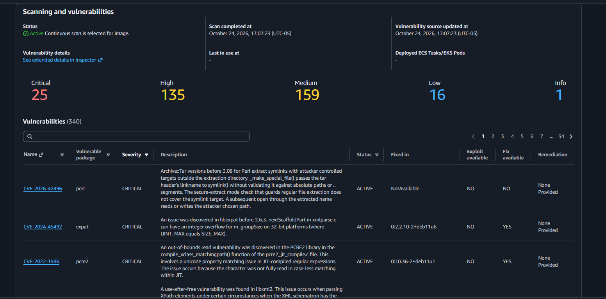

**On the Inspector dashboard.** The **Summary** page shows active findings by severity and two numbers that matter for prioritizing: how many have a public exploit, and how many have a fix.

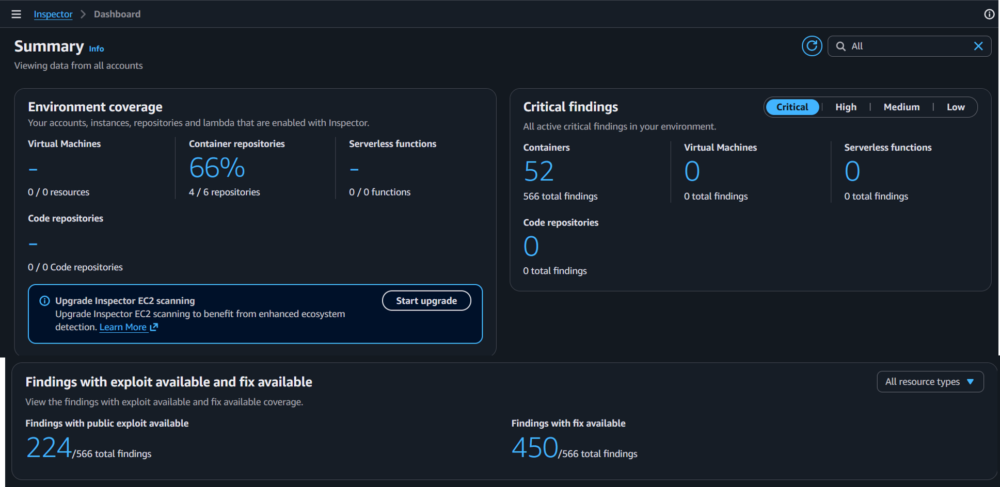

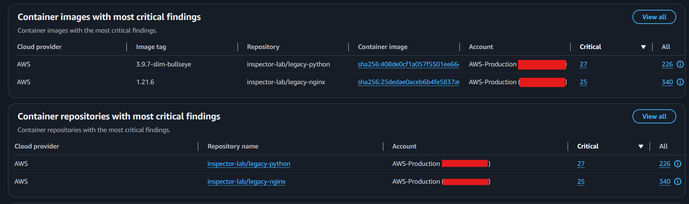

**In the Findings list.** Open one finding for the CVE, affected package, fixed-in version, and exploit and score details.

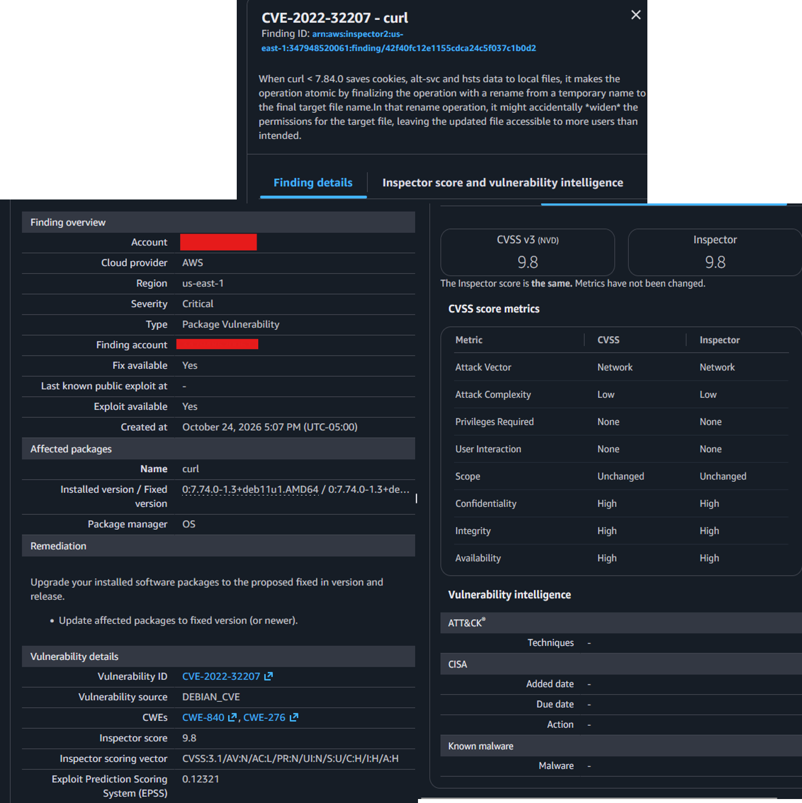

How to read what you see:

- **Severity** says how serious a vulnerability is. Critical and high first. Low can wait for routine maintenance.
- **Fix available** means a patched package exists. For container images, the usual fix is to rebuild on a newer base image.
- **Public exploit available** means working exploit code is known to exist. A critical finding with a public exploit and a fix available goes to the top of the list.
- **No fix available** is a different decision: accept the risk, add a control around it, or wait for the vendor.

### The lab's numbers

When the lab was built, the two images produced 566 active findings: 52 critical, 232 high, 249 medium, 25 low. The nginx image carried 340 and the Python image 226. 450 of 566 had a fix available, about 80 percent. 224 had a public exploit. Your numbers will differ as the vulnerability database changes.

## Suppression rules

A real team cannot work through hundreds of findings at once. A suppression rule hides findings matching a filter so the list shows what you want to act on. The lab uses a severity rule so the effect is easy to see. In real use, narrower rules such as "no fix available" are usually better.

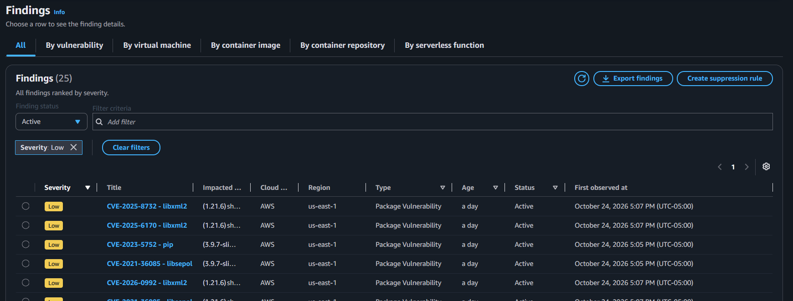

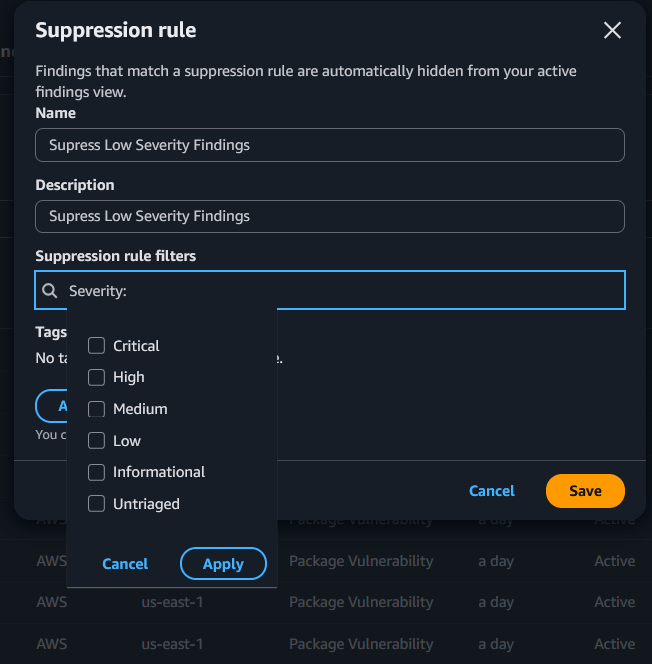

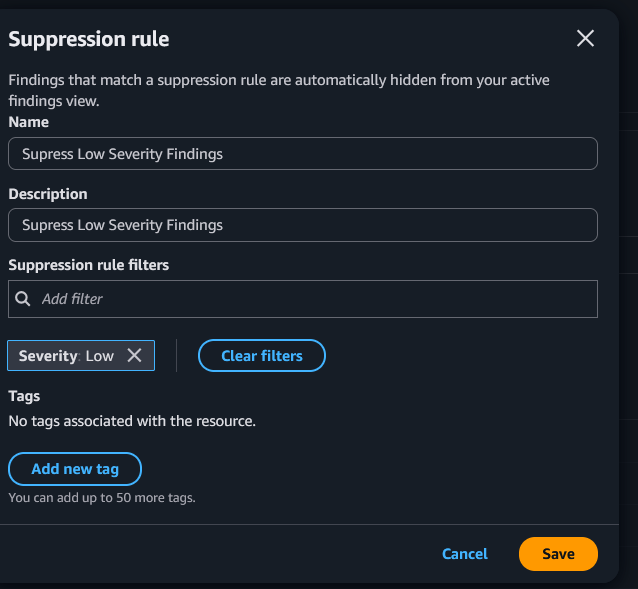

Inspector applies the rule in the background and the Active count falls in steps. While it runs, Active plus Suppressed still add up to the original total. The findings table stops counting at 200 and shows **200+**, so filter on severity for an exact before and after.

**Suppressed does not mean fixed.** The vulnerability is still there. Record why you suppressed it, who approved it, and when to review it. Suppressed findings drop out of any report built from active findings, including the scheduled exports.

[Short walkthrough of this step](https://youtu.be/EbShjNcKJtE)

## The export and the key

Inspector cannot write a report with the AWS-managed `aws/s3` key, because that key's policy cannot be edited. `storage.tf` creates a customer-managed key and a bucket, and gives the Inspector service permission to write through both the key policy and the bucket policy. Both are scoped to your account and to Inspector report ARNs only.

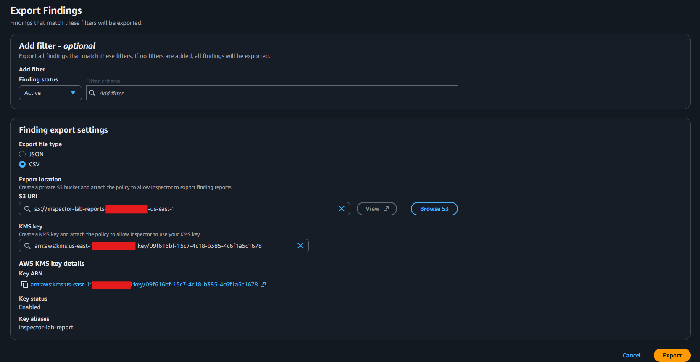

## The scheduled export

EventBridge Scheduler calls the Inspector `CreateFindingsReport` API directly, as a "universal target." No Lambda function, no custom code. Terraform creates one schedule per report format, so each run leaves a CSV and a JSON in the bucket.

The two schedules do not fire together. Inspector generates one findings report at a time per account, and a second request while one is in progress fails immediately with `ValidationException: Cannot have multiple reports in-progress`. The lab found this the hard way: on the first scheduled morning, both schedules fired in the same minute, the JSON succeeded, the CSV was rejected, and the dead-letter queue alarm emailed the operators six minutes later. Terraform now shifts each format by `export_format_stagger_minutes` (default 10), so `cron(0 4 ? * MON *)` becomes 04:00 for CSV and 04:10 for JSON. A validation error is not retried, which is why the alarm fired within minutes rather than after the retry window.

EventBridge cron has six fields: minute, hour, day of month, month, day of week, year. A weekly schedule puts `?` in the day-of-month field and a day name in the day-of-week field. `cron(0 4 ? * MON *)` is Mondays at 04:00. The schedule evaluates in `export_schedule_timezone`, and Scheduler handles daylight saving shifts.

In the console, **Amazon EventBridge**, **Schedules**, the **Schedule** tab shows the cron and the next ten run times:

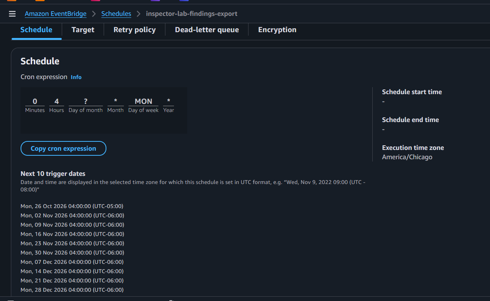

The **Target** tab shows the API call and its payload: the filter, the report format, and the S3 destination:

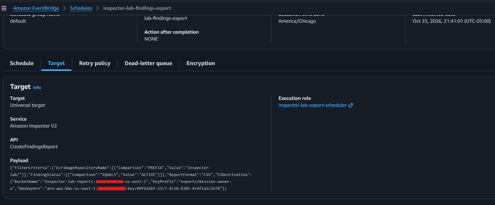

The **Dead-letter queue** tab shows the SQS queue that catches failures:

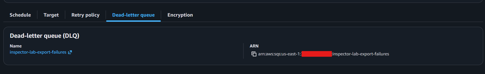

Scheduler retries a failed run twice, an hour apart. If it still fails, the error goes to the dead-letter queue. Scheduler has no console page that lists failed runs, so the queue is how you find out. An empty queue means every run succeeded. Messages stay for 14 days.

Each run adds a file with a generated name. For anything long-running, add an S3 lifecycle rule to expire old reports.

### What the scheduler's role can do

The role `inspector-lab-export-scheduler` has one inline policy. Its trust policy names only `scheduler.amazonaws.com` and requires `aws:SourceAccount` to be your account.

| Statement | Allows | Why |
| --- | --- | --- |
| `RequestFindingsReport` | `inspector2:CreateFindingsReport` on `*` | The one API call the schedule makes. The action accepts no narrower resource |
| `ReportFailuresToDeadLetterQueue` | `sqs:SendMessage` on the lab's queue only | Lets Scheduler drop an error into the dead-letter queue |

Notice what it does not have: no S3, no KMS. Inspector writes the report using the bucket and key policies that name the Inspector service. The scheduler role only asks for the report. If it were stolen, the worst it could do is request more reports.

## The delivery

### Pull, not push

The delivery repository reaches into AWS on its own schedule with short-lived credentials. Nothing in AWS holds a GitHub credential, and nothing in AWS needs to know the repository exists beyond the role's trust policy. The alternative, an S3 event that triggers a `repository_dispatch` call into GitHub, would need a GitHub token stored in AWS and a Lambda or EventBridge API destination to send it. The pull model needs neither.

### The delivery role

`delivery_role.tf` creates one role, trusted by OIDC tokens from the delivery repository's `main` branch only:

| Statement | Allows | Why |
| --- | --- | --- |
| `ListThisCustomersReports` | `s3:ListBucket`, with `s3:prefix` limited to `exports/<customer>/*` | Find the newest objects |
| `ReadThisCustomersReports` | `s3:GetObject` under `exports/<customer>/` only | Download them |
| `DecryptReports` | `kms:Decrypt` on the report key | Inspector encrypted them with it |
| `PublishDeliveryNotifications` | `sns:Publish` on the two lab topics only | Send the emails |

It cannot write to the bucket, read another customer's prefix, or call Inspector. Each customer gets their own repository, prefix, and role.

### Immutable OIDC subjects

Repositories created on github.com after July 15, 2026 send an OIDC `sub` claim of the form `repo:OWNER@OWNER_ID/REPO@REPO_ID:ref:refs/heads/main`. The numeric IDs are permanent, so the trust policy keeps working if the repository is renamed. A policy written for the older `repo:OWNER/REPO:...` form never matches it. GitHub explains the change in its [changelog](https://github.blog/changelog/2026-04-23-immutable-subject-claims-for-github-actions-oidc-tokens). The lab's troubleshooting step prints the real `sub` from a workflow run so you can copy it exactly.

### The workflow and the script

The workflow assumes the role with `aws-actions/configure-aws-credentials`, runs `scripts/fetch-latest-report.sh`, commits whatever the script wrote, and publishes a notification. The script finds the newest `.csv` and the newest `.json` separately under the customer's prefix, so a failed export in one format does not block the other. It names each file after its Inspector report ID, so two exports on one day coexist. It records every delivered object key in `.delivered`, so a run that finds nothing new changes no files, makes no commit, and sends no email. That makes a daily delivery check harmless even when the export runs monthly.

The workflow pushes to `main` with the run's own `GITHUB_TOKEN`, allowed by `permissions: contents: write`. No personal access token or deploy key. This means `main` must not be branch-protected in the delivery repository. If your organization requires protection everywhere, add the GitHub Actions app to the ruleset's bypass list, or change the workflow to push a `reports` branch.

### Why the folder date can differ from the export time

The folder date is the S3 object's `LastModified` time, in UTC. An export at 10:00 PM Central lands under the next day. The two formats are separate reports, so on rare occasions one finishes before midnight UTC and the other after, and they land in neighboring folders. `SOURCE.txt` records the report ID and generation time for each file, so the pairing is always recoverable.

### GitHub's scheduler

GitHub cron is always UTC, while the Terraform schedule uses `export_schedule_timezone`. Convert before setting the delivery cron. Scheduled runs can start a few minutes late, which is why the delivery runs an hour after the export rather than ten minutes. GitHub also pauses scheduled workflows in a repository with no commits for 60 days. A monthly delivery commits often enough to stay active.

## The notifications

Two SNS topics with two audiences.

The **delivery** topic is for readers. After the workflow commits new reports, it publishes a plain-text message with the customer, the report date, a link to the dated folder, and the file names. The link is built from the workflow's own `github.server_url` and `github.repository`, so it is correct on github.com and on GitHub Enterprise Server. Nothing is sent when a run finds nothing new, so an email always means "go look."

The **ops** topic is for the team that runs the pipeline, and it only carries bad news. A CloudWatch alarm on the dead-letter queue fires when a scheduled export fails after its retries. A final workflow step guarded by `if: failure()` publishes the run URL when any earlier step failed. Silence on this topic means every run succeeded, so when readers notice silence on an expected day, the operators already know why.

SNS email is plain text with a 100-character subject. The email carries a link, never the report, so it is safe to forward. Every subscriber must click the confirmation link AWS sends. Terraform cannot confirm on anyone's behalf.

The topics are not encrypted with a customer-managed key. Messages carry a repository URL, a folder name, and file names, never finding data. CloudWatch alarms cannot publish to a topic encrypted with the AWS-managed SNS key, and a customer-managed key would need a key policy statement for `cloudwatch.amazonaws.com`. If your environment mandates CMK on every topic, that is the change to make.

## Public repositories and account IDs

Workflow logs on a public repository are public. Both lab workflows pass `mask-aws-account-id: true`, so the bucket name and key ARN print with `***` where the 12 digits would be. If you fork the lab into a public repository, keep that masking in place. The lab run hit two errors before the first green push: a missing region variable, then a trust policy mismatch.

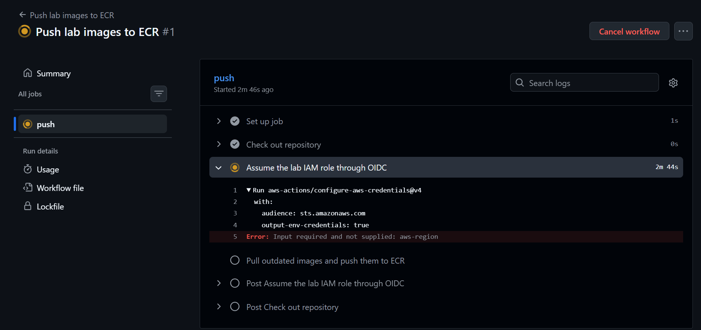

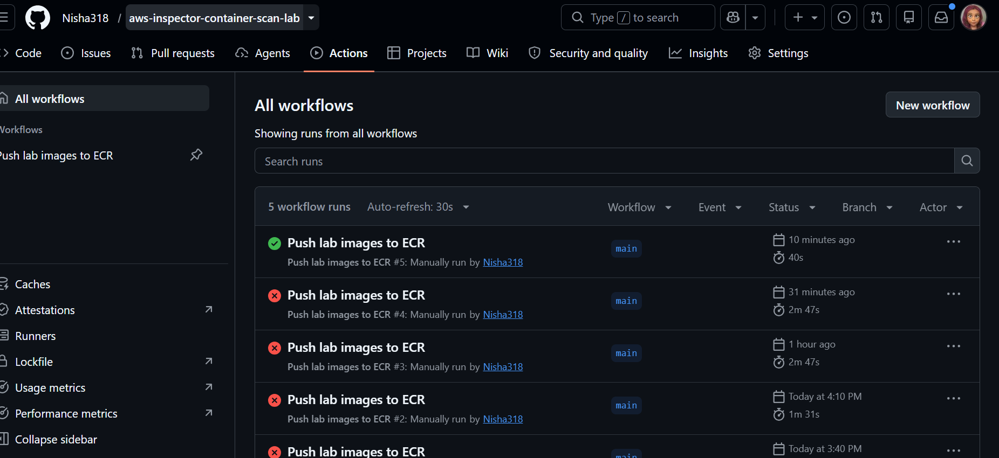

## What comes next

The reports now arrive on their own. The next phase ranks and deduplicates the findings into a `SUMMARY.md` beside the raw files, one row per resource and package, worst first, with what changed since the last run, and opens one GitHub Issue per row so the work is tracked where the reports already live.
